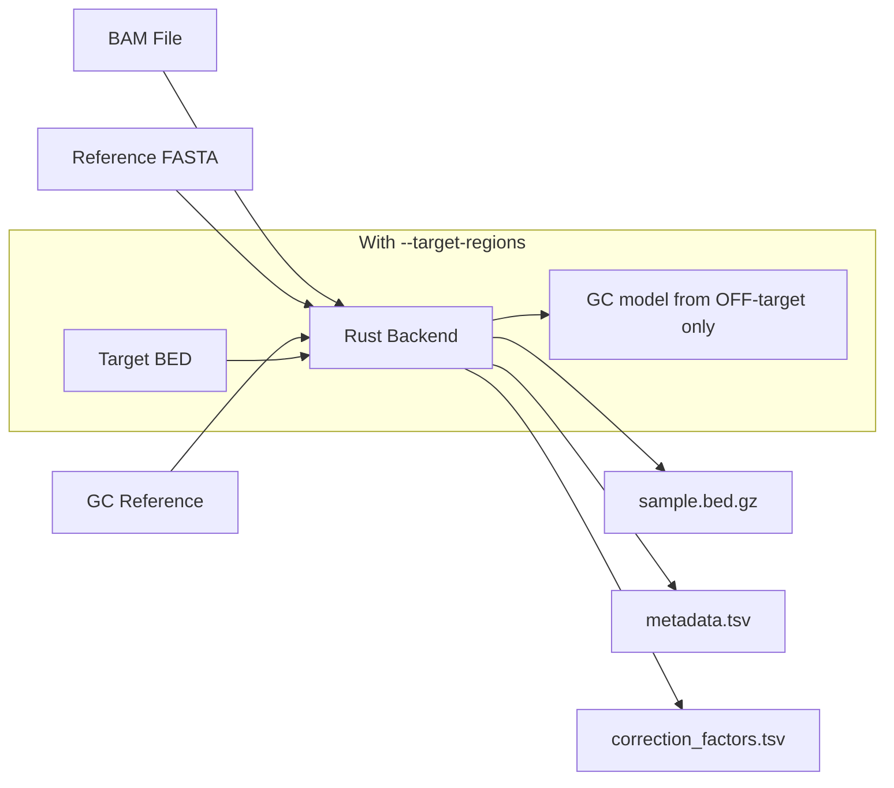
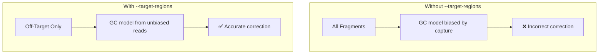

# Fragment Extraction

**Command**: `krewlyzer extract`

!!! info "Plain English"
    Extract converts your BAM file into cfDNA fragments with quality information.
    It's the first step for most analyses—think of it as "preprocessing" your sequencing data.

    **Key output**: `.bed.gz` file containing fragment coordinates and GC correction factors.

---

## Purpose
The `extract` module serves as the entry point for most analysis workflows. It processes a BAM file to extract valid cell-free DNA (cfDNA) fragments and saves them in a standardized, compressed BED format with GC content.

---

## Processing Flowchart



---

## Biological Context
Raw sequencing data (BAM) contains reads that must be paired and filtered to reconstruct physical DNA fragments. This step standardizes the data, removing PCR duplicates and low-quality mappings, ensuring downstream analysis focuses on high-confidence unique molecules.

---

## Usage
```bash
krewlyzer extract -i sample.bam -r hg19.fa -o output_dir/ [options]
```

## Options

| Option | Short | Type | Default | Description |
|--------|-------|------|---------|-------------|
| `--input` | `-i` | PATH | *required* | Input BAM file |
| `--reference` | `-r` | PATH | *required* | Reference genome FASTA (indexed) |
| `--output` | `-o` | PATH | *required* | Output directory |
| `--genome` | `-G` | TEXT | hg19 | Genome build for bundled assets (targets, blacklist, GC reference); an unknown build is an error, and so is a bundled file the run needs that is missing (see `--assay` and `--exclude-regions`) |
| `--assay` | `-A` | TEXT | | Assay code (xs1/xs2) for auto-loading bundled targets. A named assay whose bundled targets are missing is an error, not WGS; `wgs` has none by design |
| `--target-regions` | `-T` | PATH | | Target BED (panel mode: GC from off-target) |
| `--skip-target-regions` | | FLAG | | Disable panel mode even when --assay is specified |
| `--gc-correct` | | FLAG | True | Compute GC correction factors. `--no-gc-correct` skips only the factor tables: `--assay` targets and the blacklist still apply, as in `run-all` |
| `--exclude-regions` | `-x` | PATH | bundled blacklist | BED file of regions to exclude (default: the genome's bundled blacklist, with or without `--gc-correct`; if it is missing, that is an error). To exclude nothing, pass an empty file |
| `--mapq` | `-q` | INT | 20 | Minimum mapping quality |
| `--minlen` | | INT | 65 | Minimum fragment length |
| `--maxlen` | | INT | 1000 | Maximum fragment length |
| `--skip-duplicates` | | FLAG | True | Skip duplicate reads |
| `--require-proper-pair` | | FLAG | True | Require proper read pairs |
| `--sample-name` | `-s` | TEXT | | Override sample name |
| `--verbose` | `-v` | FLAG | | Enable verbose logging |
| `--threads` | `-t` | INT | 0 | Number of threads (0=all) |

---

## Output Files

| File | Description |
|------|-------------|
| `{sample}.bed.gz` | Block-gzipped BED with fragment coordinates + GC |
| `{sample}.bed.gz.tbi` | Tabix index for random access |
| `{sample}.metadata.tsv`  | Run statistics and configuration (tabular) |
| `{sample}.correction_factors.tsv` | GC correction factors (with --gc-correct), when at least one length bin had enough fragments to fit |

`{sample}.metadata.*` is the sample's record, and downstream's completion marker. It repeats the
filters this run applied (`filters_mapq`, `filters_min_length`, `filters_max_length`,
`filters_skip_duplicates`, `filters_require_proper_pair`, and `filters_blacklist_sha256`, the
blacklist's SHA-256) and says in `gc_correction_computed` whether the off-target factor table was
written.

`extract` refuses, before writing anything, a folder that holds any feature table for the sample
(UXM's aside: it reads the BAM at a fixed mapq, never the BED) or whose record run-all or a single
tool has written into: a new BED would leave the tables made from the old one looking current, and
replacing that record would drop its provenance and stage columns. Rerunning `extract` over a
folder it wrote alone is allowed, with the same genome, assay, targets, format and filters; other
filters are refused like any other setting. run-all reuses a BED `extract` wrote only when the
filters match; with others it is refused.

`--chromosomes` was removed. It was accepted and ignored, so a run asking for one chromosome
wrote the whole genome; it is now refused as an unknown option. There is no chromosome subset:
to lower memory, lower `--threads`.

### GC Correction Factors Format

| Column | Description |
|--------|-------------|
| `len_bin` | Fragment length bin (0-16) |
| `gc_bin` | GC content (0.00-1.00) |
| `factor` | Correction multiplier |
| `observed` | Raw fragment count |
| `expected` | LOESS-predicted count |
| `n_fragments` | Number of fragments in bin |

---

## Panel Mode (--assay or --target-regions)

For targeted sequencing panels (MSK-ACCESS), use `--assay` to auto-load bundled targets, or `--target-regions` for a custom target file:

```bash
# Recommended: Auto-load bundled targets for xs2 assay
krewlyzer extract -i sample.bam -r hg19.fa -o output/ --assay xs2

# Alternative: Explicit target file
krewlyzer extract -i sample.bam -r hg19.fa -o output/ \
    --target-regions MSK-ACCESS_targets.bed
```

### Why This Matters



**Problem**: On-target fragments have GC bias from hybridization probes. Using all fragments for GC modeling contaminates the correction factors.

**Solution**: With `--target-regions`, only **off-target** fragments are used to compute GC correction factors, producing unbiased normalization for downstream analysis.

### Outputs in Panel Mode

| Output | Description |
|--------|-------------|
| `correction_factors.tsv` | GC factors from **off-target only** (unbiased) |
| `correction_factors.ontarget.tsv` | GC factors from **on-target only** (for mFSD) |
| `sample.bed.gz` | All fragments (on + off-target) |

!!! tip
    Use `.correction_factors.ontarget.tsv` with `krewlyzer mfsd --correction-factors` for panel variant calling—it's trained on the same capture regions as your variants.

!!! important
    The BED file contains all fragments. Target filtering happens **per-tool** using the same `--target-regions` flag in FSC, FSD, WPS, etc.

---

## BAM Compatibility

### Duplex/Consensus BAMs

If you're using duplex or consensus BAMs, disable the proper pair filter:

```bash
krewlyzer extract -i duplex.bam -r hg19.fa -o output/ \
    --no-require-proper-pair
```

| BAM Type | Proper Pairs? | Flag Needed? |
|----------|---------------|--------------|
| Standard WGS | ✅ Yes | Default works |
| Standard Panel | ✅ Yes | Default works |
| Duplex/UMI | ❌ No | `--no-require-proper-pair` |
| Consensus | ❌ No | `--no-require-proper-pair` |

### Auto-Detection

The `run-all` command automatically detects BAM compatibility issues and suggests the correct flags.

---

## See Also

- [GC Correction](../../guides/gc-correction.md) - LOESS algorithm details
- [Troubleshooting](../../resources/troubleshooting.md) - Common issues
- [Glossary](../../reference/glossary.md) - Terminology reference
