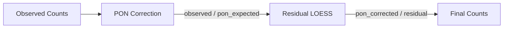

# GC Bias Correction

GC content bias is a major source of variability in cfDNA sequencing. Krewlyzer implements LOESS-based correction in Rust for high performance.

## Why GC Correction?

DNA fragments with extreme GC content (very AT-rich or GC-rich) are under-represented due to:

1. **PCR amplification bias** - GC-rich regions amplify less efficiently
2. **Sequencing bias** - Certain GC ranges have lower quality scores
3. **Capture bias** - Hybridization efficiency varies with GC

Without correction, fragment counts are confounded by GC content, obscuring biological signal.

---

## How It Works

### LOESS Regression

Krewlyzer uses **Locally Estimated Scatterplot Smoothing (LOESS)** to model the relationship between GC content and fragment count:

```
For each fragment type (short, intermediate, long):
1. Bin fragments by GC content (0.00-1.00 in 0.01 steps)
2. Fit LOESS curve: count = f(gc)
3. Compute correction factor: factor[gc] = median(count) / loess_fit[gc]
4. Apply: corrected_count = raw_count × factor[gc]
```

### Configuration

| Parameter | Default | Description |
|-----------|---------|-------------|
| LOESS fraction | 0.3 | Fraction of data for local fitting |
| LOESS iterations | 3 | Robustness iterations |
| Delta | 0.01 | Smoothing delta |

---

## Fragment Length Bins

GC correction is applied per fragment length bin (17 bins, 20bp width):

| Bin | Range | Fragment Type |
|-----|-------|---------------|
| 0 | 60-79bp | Ultra-short |
| 1 | 80-99bp | Ultra-short |
| 2-4 | 100-159bp | Short |
| 5-7 | 160-219bp | Intermediate |
| 8-16 | 220-400bp | Long |

---

## Usage

### Automatic (Default)

GC correction is **enabled by default** for most tools:

```bash
krewlyzer extract -i sample.bam -r hg19.fa -o output/
# Generates: sample.correction_factors.tsv
```

### Disable GC Correction

```bash
krewlyzer fsc -i sample.bed.gz --no-gc-correct -o output/
```

### Using Pre-computed Factors

```bash
# mFSD can use factors from extract. It computes each fragment's GC from the
# reference, so the reference is required with them.
krewlyzer mfsd -i sample.bam -V variants.vcf -g reference.fa \
    --correction-factors output/sample.correction_factors.tsv \
    -o output/
```

---

## Per-Tool GC Correction

| Tool | GC Option | Source | Notes |
|------|-----------|--------|-------|
| **extract** | `--gc-correct` | Computes factors | Generates `.correction_factors.tsv` |
| **FSC** | `--gc-correct` | From extract | Via `run_unified_pipeline` |
| **FSR** | `--gc-correct` | From extract | Via `run_unified_pipeline` |
| **FSD** | `--gc-correct` | From extract | Via `run_unified_pipeline` |
| **WPS** | `--gc-correct` | From extract | Via `run_unified_pipeline` |
| **OCF** | `--gc-correct` | From extract | Via `run_unified_pipeline` |
| **Region Entropy** | `--gc-correct`, `--gc-factors` | From extract | TFBS/ATAC fragment weighting |
| **Region MDS** | | N/A | Uses raw motif counts (no GC correction) |
| **mFSD** | `--correction-factors` | Manual input | Uses pre-computed CSV |
| **motif** | N/A | N/A | No GC correction |
| **UXM** | N/A | N/A | No GC correction |

### Panel Data (--target-regions)

When `--target-regions` is provided to `extract`:
- GC model is built from **off-target** fragments only
- Avoids capture bias contamination
- Generates both `.correction_factors.*` (off-target) and `.correction_factors.ontarget.*` (on-target), in the run's `--output-format`

**Which table a feature uses.** Every consumer finds its table through one resolver
(`core.gc_assets.resolve_gc_factors`): beside the BED only, where extraction wrote it with the
BED's fragments; Parquet, then `.tsv.gz`, then `.tsv`. TSV keeps full precision, so all three carry identical
factors and GC correction does not depend on the output format. Each sample's metadata records
the kind of table each population used (`gc_factors_offtarget`, `gc_factors_ontarget`).

**Only extraction fits a table.** When it fitted no off-target table (a panel whose targets hold
almost every fragment), or the table is not beside the BED, no feature step fits one: run-all and
the tools on the unified pipeline (`fsc`, `fsr`, `fsd`, `wps`, `ocf`) run the features that correct
with it uncorrected, and warn. run-all records `gc_correction_applied_offtarget=False`; a single
tool records it only into extraction's record, and only while no run has recorded one. A table
elsewhere, such as in the folder a tool writes to, is never used: it may be another extraction's.
Nor is one beside the BED when extraction's record says it wrote none
(`gc_correction_computed=False`): a feature step of an earlier build fitted it there, under
extraction's name. With no record beside the BED, as in a `build-pon --keep-sample-outputs` cache
kept by 0.9.2 or earlier, the table there is used, whatever wrote it. `build-pon` refuses a donor without extraction's table,
from a BAM or a BED, and stops; with `--allow-failures` it leaves the donor out. `--from-outputs`
refuses a donor recorded as corrected with a table extraction did not write.

!!! warning "0.9.x cohorts"
    Up to 0.9.2, panel WPS, every TFBS and ATAC table, and gene FSC looked only for a plain
    `.tsv` factor table. Runs with `--output-format parquet`, or with `--compress` (the Nextflow
    default), write none, so those features ran **without GC correction**, while PON donors
    (built with TSV forced) were corrected. Gene FSC was uncorrected for samples and donors
    alike. Re-run those cohorts; `build-pon --from-outputs` refuses sample directories from
    before the fix.

---

## Building GC Reference Assets

The `build-gc-reference` command pre-computes reference GC data:

```bash
# Standard (WGS) mode
krewlyzer build-gc-reference hg19.fa -o data/gc/ -e hg19-blacklist.bed

# Panel mode (generates both WGS and on-target assets)
krewlyzer build-gc-reference hg19.fa -o data/gc/ -T msk_targets.bed
```

### Output Files

| Mode | File | Description |
|------|------|-------------|
| Standard | `valid_regions_{genome}.bed.gz` | 100kb bins for GC estimation |
| Standard | `ref_genome_GC_{genome}.parquet` | Expected fragment counts |
| Panel | `valid_regions_{genome}.ontarget.bed.gz` | Bins overlapping targets |
| Panel | `ref_genome_GC_{genome}.ontarget.parquet` | On-target expected counts |

### Options

| Option | Description |
|--------|-------------|
| `-o, --output` | Output directory (required) |
| `-e, --exclude-regions` | Blacklist BED to exclude |
| `-T, --target-regions` | Target BED for panel mode |
| `--bin-size` | Bin size in bp (default: 100kb) |
| `-n, --genome-name` | Genome name (default: from FASTA) |

## Correction Factors File

The `extract` command generates `{sample}.correction_factors.tsv` (or `.tsv.gz` with `--compress`):

```tsv
length_bin_min	length_bin_max	gc_percent	observed	expected	correction_factor
75	80	36	53	1281884	1.0000
75	80	39	56	1259020	1.0000
...
```

| Column | Description |
|--------|-------------|
| `length_bin_min` | Fragment length bin lower bound (bp) |
| `length_bin_max` | Fragment length bin upper bound (bp) |
| `gc_percent` | GC content percentage (0–100) |
| `observed` | Raw fragment count |
| `expected` | Expected count from LOESS model |
| `correction_factor` | `expected / observed` — multiply raw counts by this |

---

## PON-based Hybrid Correction

When a PON model is provided, correction uses a **hybrid approach**:



**Algorithm:**
1. **PON correction**: Divide by assay-specific expected coverage
2. **Residual LOESS**: Fit sample-specific residual bias
3. **Final**: Divide PON-corrected counts by residual

This removes both assay-wide and sample-specific GC effects.

---

## Implementation Details

### Rust Module: `gc_correction.rs`

Key structures:

```rust
/// Fragment length bins (17 bins, 60-400bp)
pub struct LengthBin(u8);

/// GC correction factors lookup
pub struct CorrectionFactors {
    factors: HashMap<(LengthBin, u8), f64>,
    stats: HashMap<(LengthBin, u8), CorrectionBinStats>,
}

/// Apply LOESS-based correction
pub fn correct_gc_bias(
    gc_values: &[f64],
    counts: &[f64],
    config: Option<GcCorrectionConfig>
) -> Result<Vec<f64>>
```

### Python Interface

```python
from krewlyzer import _core

# Compute and save correction factors
_core.gc.compute_and_write_gc_factors(
    bed_path="sample.bed.gz",
    gc_reference_path="gc_reference.parquet",
    output_path="correction_factors.tsv",
    output_format="both",   # "tsv", "parquet", or "both"
    compress=True,           # gzip-compress TSV output
)
```

---

## When to Disable

Disable GC correction (`--no-gc-correct`) when:

- Comparing raw signal across samples with known GC differences
- Validating uncorrected patterns
- Working with very small regions where LOESS may be unstable

For most applications, **keep correction enabled** (default).
